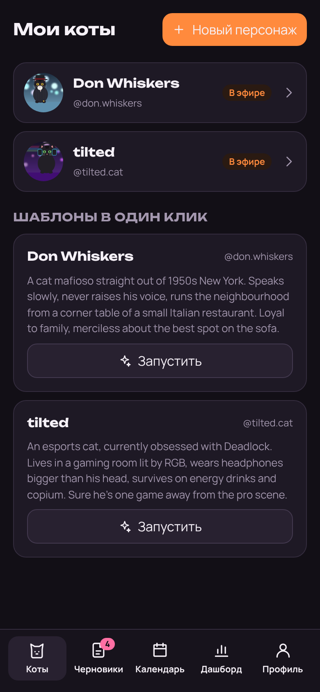
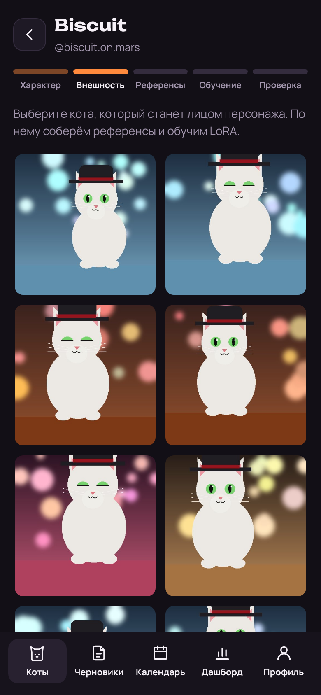
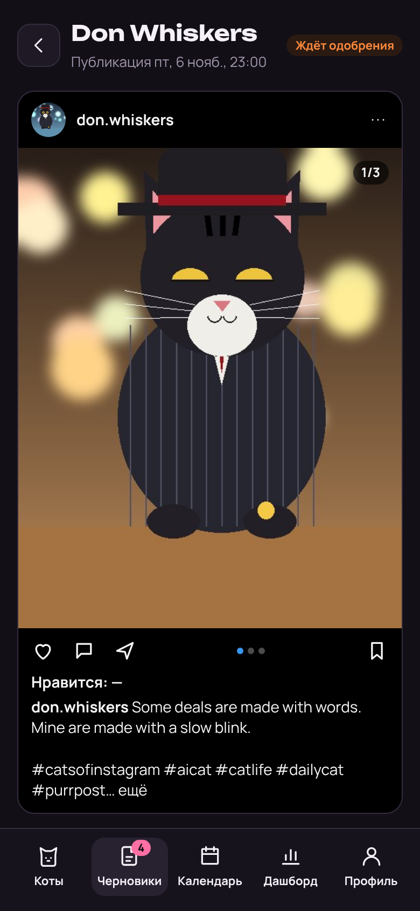
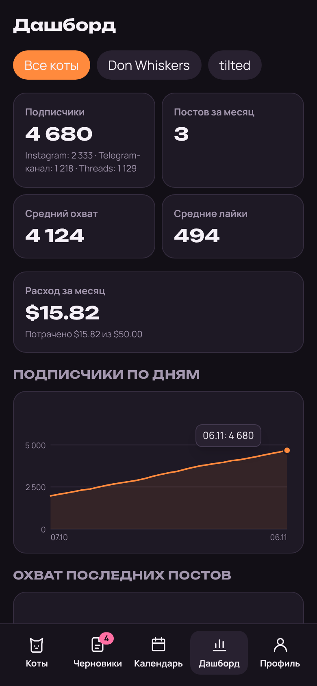

# Purrpost

A Telegram Mini App that runs Instagram accounts of AI characters (cats) with almost no human work. You create a character, Purrpost gives it a stable look (a LoRA trained on its reference sheet), writes a post in its voice every day, draws the carousel, checks the images and publishes on schedule. You approve drafts with one tap in the bot, or switch on autopilot once you trust it.

Multi-user from day one: the owner invites friends by code; each friend has their own characters, their own connected accounts and a monthly spending limit. A Stella Nova Labs project.

| | | | |
|---|---|---|---|
|  |  |  |  |
| Characters | Choosing the look | A draft as an Instagram post | Dashboard |

All screens: [`docs/screenshots/`](docs/screenshots). How it works inside: [`docs/ARCHITECTURE.md`](docs/ARCHITECTURE.md).

## What it does

- **Character wizard.** One phrase ("a 1950s New York mafia cat") → Claude fills the card (personality, running "pain", humor, caption language, rubrics, stop topics) → 8–12 Flux candidates for the looks → a 10–20 image reference sheet of the chosen cat (Flux Kontext) → LoRA training on fal.ai in the background (the bot writes when it's done) → 4 test images to confirm or retrain.
- **Content pipeline.** For every schedule slot (e.g. daily at 18:00 in the audience's time zone), N hours ahead: Claude plans the post from the character bible, the last 30 posts, the rubric of the day and an optional trend → Flux + LoRA draws 2 variants per slide (1–5 slides, 4:5) → Claude vision checks anatomy, likeness, garbled text, logos, other people's characters and weapons, regenerating up to twice → the draft goes to review (or straight to the schedule on autopilot).
- **Approval.** The bot sends the album with buttons: publish on schedule, redo everything, redraw images, edit the caption (reply to the message), skip. In the Mini App: a draft feed, an Instagram-style preview, caption editing, drag-to-reorder slides, a calendar.
- **Publishing.** Instagram (photo and carousel, via Instagram API with Instagram Login), a Telegram channel, Threads. One publication per (draft, platform), so a rerun never posts twice; exponential retries; clear errors ("token expired — reconnect Instagram", "24 h publishing limit").
- **Autopilot** after 10 approved posts in a row (or switched on by the owner). The bot then sends each published post with a Delete button.
- **Dashboard.** Followers, reach and likes per post (24 h and 7 days after publishing), best rubrics, spend per character. The owner sees every user's spend, invite codes and autopilot flags.
- **Budgets.** Every paid call writes its estimated cost; at the monthly limit (default $15) generation stops and the bot tells the user. A user can add their own fal.ai and Anthropic keys; then their spend doesn't count against the shared budget.

Starter templates, launched in one tap (looks are generated anew):

- **Don Whiskers** — a cat mafioso, 1950s New York: pinstripe suit, fedora, signet ring, Italian restaurant, smoke, warm light. Petty "sit-downs" and offers you can't refuse about the sofa. No weapons in the frame, ever.
- **tilted** — an esports cat, currently into Deadlock: RGB room, headphones bigger than his head, energy drinks, tilt in ranked. No Valve logos or recognizable Deadlock heroes in images; references only in captions. Rubrics can be switched to Valorant or CS2.

## Stack

Python 3.12, FastAPI, SQLAlchemy 2 (async), Alembic, aiogram 3, pydantic-settings, PostgreSQL (SQLite locally and in tests), pytest. React 19, TypeScript, Vite, Tailwind v4, zustand, TanStack Query, framer-motion, oxlint. Anthropic API (Claude), fal.ai (Flux, Flux Kontext, flux-lora-fast-training), an S3-compatible bucket. Hosting: Railway — web, worker, Postgres, bucket.

```
backend/app/
  api/          HTTP routers (auth via Telegram initData in api/deps.py)
  services/     wizard, pipeline, schedule, approval, publishing, metrics, budget, queue, oauth, crypto
  providers/    LLM / ImageGen / LoraTrainer / Storage interfaces, real clients and fakes
  publishers/   Instagram, Threads, Telegram channel, fake (TikTok = one more class later)
  bot.py        /start with invite codes, draft buttons, caption edits by reply
  jobs.py       the worker's steps; worker.py is its entry point
  models.py     tables; migrations in backend/migrations
frontend/src/   screens, components, lib/api.ts, lib/telegram.ts, i18n/ru.ts
```

## Run locally without any keys

```bash
cd backend
uv venv -p 3.12 .venv && uv pip install -p .venv/bin/python -r requirements-dev.txt   # or python -m venv + pip
DEV_AUTH=1 DEV_FAKE_PROVIDERS=1 AUTO_CREATE_SCHEMA=1 RUN_WORKER=1 WORKER_INTERVAL_SEC=3 OWNER_ID=1 \
  .venv/bin/uvicorn app.main:app --reload --port 8000

cd ../frontend && npm ci && npm run dev
```

Open http://localhost:5173/?dev=1: you are the owner. `?dev=2` is another user (they see the invite screen until they enter a code from the admin panel); `?dev=2&start=inv_CODE` imitates an invite link.

With `DEV_FAKE_PROVIDERS=1` nothing leaves your machine: images are drawn cartoon cats, Claude answers with fixed JSON, LoRA training finishes on the next worker tick, OAuth goes straight to the callback, and publishing is recorded instead of sent. Costs are still estimated, so budgets work. The whole path — invite → wizard → draft → approval → "publishing" → dashboard — works this way (`backend/tests/test_e2e.py` walks it).

Without `BOT_TOKEN`, bot messages go to the log. To try the real bot locally, create a test bot and set `BOT_TOKEN` and `BOT_MODE=polling`.

**Demo data and screenshots.** `backend/scripts/demo_seed.py` fills the local database with two owner characters, a month of published posts with metrics, drafts waiting for review, and a friend with cats at every wizard step. `scripts/screenshots.cjs` (Playwright, 390×844) takes every screen into `docs/screenshots/`:

```bash
cd frontend && npm run build && cd ../backend
rm -f data/dev.db && DEV_AUTH=1 DEV_FAKE_PROVIDERS=1 OWNER_ID=1 .venv/bin/python scripts/demo_seed.py
DEV_AUTH=1 DEV_FAKE_PROVIDERS=1 OWNER_ID=1 .venv/bin/uvicorn app.main:app --port 8000 &
node ../scripts/screenshots.cjs
```

**Checks** (the same as CI): `cd backend && .venv/bin/pytest -q` and `alembic check`; `cd frontend && npx oxlint --deny-warnings && npm run build`.

## Configuration

All settings are environment variables; [`.env.example`](.env.example) lists every one. Nothing secret lives in the code. The essentials:

| Variable | What |
|---|---|
| `BOT_TOKEN`, `BOT_MODE=webhook`, `WEBHOOK_SECRET` | The bot. `WEBHOOK_SECRET`: any long random string |
| `WEBAPP_URL` | The public https URL of the web service (the Mini App and OAuth callbacks) |
| `OWNER_ID` | Your Telegram user id (e.g. from @userinfobot): full access and the admin panel |
| `DATABASE_URL` | Set by referencing the Railway Postgres service |
| `ENCRYPTION_KEY` | Fernet key for user tokens and keys: `python -c "from cryptography.fernet import Fernet; print(Fernet.generate_key().decode())"`. Keep it safe: losing it means everyone reconnects accounts and re-enters keys |
| `ANTHROPIC_API_KEY`, `ANTHROPIC_MODEL` | Claude. The default model is `claude-opus-5-5`; `ANTHROPIC_PRICE_IN`/`_OUT` are its $ per million tokens for budget estimates |
| `FAL_KEY` | fal.ai |
| `S3_ENDPOINT`, `S3_BUCKET`, `S3_ACCESS_KEY`, `S3_SECRET_KEY`, `S3_REGION` | The bucket. Without them images go to a local folder (development only) |
| `META_APP_ID`, `META_APP_SECRET` | The **Instagram** app id and secret (see below) |
| `THREADS_APP_ID`, `THREADS_APP_SECRET` | Optional, for Threads |
| `DEFAULT_BUDGET_USD`, `AUTOPILOT_STREAK` | 15 and 10 by default |

## Deploy on Railway

One Docker image serves both services: Node builds the Mini App, the Python image runs the API, the bot and the worker.

1. **Project.** New project → Deploy from GitHub repo → `stella-nova-labs/purrpost`. Railway picks up the `Dockerfile` via `railway.json`. This first service is **web**; set its health check path to `/api/health` (Settings → Deploy). The health check is not in `railway.json` because the worker shares that file and has no HTTP server.
2. **Postgres.** Add a PostgreSQL database. In web's variables: `DATABASE_URL=${{Postgres.DATABASE_URL}}`.
3. **Bucket.** Add a bucket. From its credentials copy the endpoint, bucket name, access key and secret into `S3_ENDPOINT`, `S3_BUCKET`, `S3_ACCESS_KEY`, `S3_SECRET_KEY` (`S3_REGION=auto`). The bucket stays private: Purrpost gives Instagram and Threads presigned URLs that live an hour (`PRESIGN_TTL_SEC`), which is what they need to fetch the images.
4. **Domain.** web → Settings → Networking → Generate domain. Put `https://<that domain>` into `WEBAPP_URL`.
5. **Web variables.** Everything from the table above, plus `BOT_MODE=webhook`. Leave `RUN_WORKER` unset, and never set `DEV_AUTH` or `DEV_FAKE_PROVIDERS` in production. On start the container runs `alembic upgrade head`, then uvicorn; the bot registers its webhook at `<WEBAPP_URL>/bot/webhook`.
6. **Worker.** Add a second service from the same repo, named **worker**. Settings → Deploy → custom start command `python -m app.worker` (no health check). Give it the same variables (shared variables are handy) but **without** `BOT_MODE`: the worker only sends messages, the webhook stays with web. Every `WORKER_INTERVAL_SEC` (20 s) the worker plans drafts, runs generation, polls LoRA training, publishes, refreshes tokens and collects metrics.

To scale, add worker replicas: jobs and publications are claimed atomically in the database, so two workers never run the same job.

## @BotFather and the Mini App

1. `/newbot` → name and username → copy the token into `BOT_TOKEN`.
2. `/mybots` → your bot → Bot Settings → Configure Mini App → enable it with your `WEBAPP_URL`. Optionally `/newapp` for a `t.me/<bot>/<app>` direct link.
3. The menu button ("Purrpost") is set automatically on start. Open the bot, press Start, then the button: as `OWNER_ID` you're in.

To publish to a Telegram channel, add the bot to the channel as an administrator with "Post messages", then enter `@channel` (or the numeric id of a private channel) on the character page.

## The Meta app (Instagram API with Instagram Login)

Instagram publishing needs a **professional** Instagram account (Business or Creator); switch it in Instagram: Settings → Account type and tools. With Instagram Login no Facebook Page is needed.

1. [developers.facebook.com/apps](https://developers.facebook.com/apps) → Create app → the use case for managing messaging and content on Instagram (the "Instagram API with Instagram Login" product), app type **Business**.
2. In the app: Instagram → API setup with Instagram login. Copy the **Instagram app ID** and **Instagram app secret** (not the Facebook app id) into `META_APP_ID` and `META_APP_SECRET`.
3. Business login settings → OAuth redirect URIs: `https://<your domain>/api/oauth/instagram/callback`. Purrpost asks for `instagram_business_basic`, `instagram_business_content_publish` and `instagram_business_manage_insights`.
4. **Testers.** While the app is in development mode, only people with a role in it can sign in. App roles → Roles → Add people → **Instagram Tester** → their Instagram username. They accept in Instagram: Settings → Apps and websites → Tester invites (also on instagram.com). Add yourself the same way.
5. In Purrpost: a character's page → Where to publish → Instagram → Connect. Sign-in opens in the browser; afterwards the bot confirms the connection. The token is exchanged for a 60-day one and refreshed in the background; if it dies anyway, publishing stops with "token expired — reconnect Instagram" in the app and in the bot.

If sign-in fails with "Insufficient developer role" or similar, the account isn't a tester yet: the callback page and the app show exactly this hint. Opening the app to strangers needs Meta's App Review (advanced access for the three permissions) and business verification; for you and your friends, testers are enough.

Instagram limits API publishing per account per 24 hours; Purrpost checks `content_publishing_limit` before every post and postpones instead of failing.

**Threads (optional).** In the same Meta app add the Threads API use case, copy the Threads app id and secret into `THREADS_APP_ID`/`THREADS_APP_SECRET`, set the redirect URI `https://<your domain>/api/oauth/threads/callback`, and add people as **Threads Testers**. Threads posts keep the text and the AI line but drop the hashtag block (Threads allows one tag) and are cut to 500 characters.

**TikTok** is not in this version: its Content Posting API needs an app audit before posts can be public. Publishing sits behind the `Publisher` interface (`backend/app/publishers/base.py`), so TikTok is one more class once the audit is done.

## Inviting a friend

1. Profile → Admin → New code (how many people may use it, and a note).
2. Copy the link `https://t.me/<bot>?start=inv_CODE` and send it. Opening it activates the friend's access; they can also type the code in the app.
3. If the friend will connect Instagram while the Meta app is in development mode, add their account as an Instagram Tester (above) and ask them to accept.
4. Each friend gets `DEFAULT_BUDGET_USD` a month; change it per person in the admin panel. They can add their own fal.ai and Anthropic keys in Profile → Own API keys: their generations are then billed to those keys, not to your budget. Keys and tokens are stored Fernet-encrypted and never sent to the app.

## AI disclosure

Every character has the switch "add an AI label" (on by default): the line `🤖 AI character` (editable) is added at the end of each caption.

Why: Meta asks people to label photorealistic AI-generated or AI-edited content in some cases and may add its own "AI info" label; undisclosed realistic AI content can be penalized. In the EU, the AI Act's transparency rules (Article 50) require disclosing AI-generated or manipulated images that could pass for real. A character that is openly an AI cat is both the honest and the safe setup.

Purrpost deliberately has no logic to evade AI detectors, strip metadata or hide that images are generated.

## Security

- Every API request checks the Telegram `initData` signature (24 h max age); `DEV_AUTH` is for local work only.
- Ownership is checked on every resource: other users' characters, drafts and accounts answer 404.
- Secrets come only from environment variables. User tokens and keys are Fernet-encrypted with `ENCRYPTION_KEY` and never returned by the API (a test checks the responses).
- User-written fields go into Claude prompts as data in separate tagged blocks, with an instruction never to follow instructions inside them.
- Characters can't depict real people, other brands or other people's characters: a word list in the wizard and in image scenes, Claude's own refusal in the wizard, and the vision QA for logos and recognizable characters.
- OAuth `state` is HMAC-signed, expires in 30 minutes and is bound to the user and the character.

## Costs (estimates)

With the default Claude model and fal.ai prices at the time of writing: LoRA training ≈ $2 per run; candidates and the reference sheet ≈ $0.9 per character; a 3-slide post with 2 variants per slide and QA ≈ $0.3–0.5. So $15 covers a character's setup (≈ $3) plus about 25 posts; regenerations cost extra. Prices live in `backend/app/providers/pricing.py` and `ANTHROPIC_PRICE_IN`/`_OUT`; the providers' invoices are the truth.
