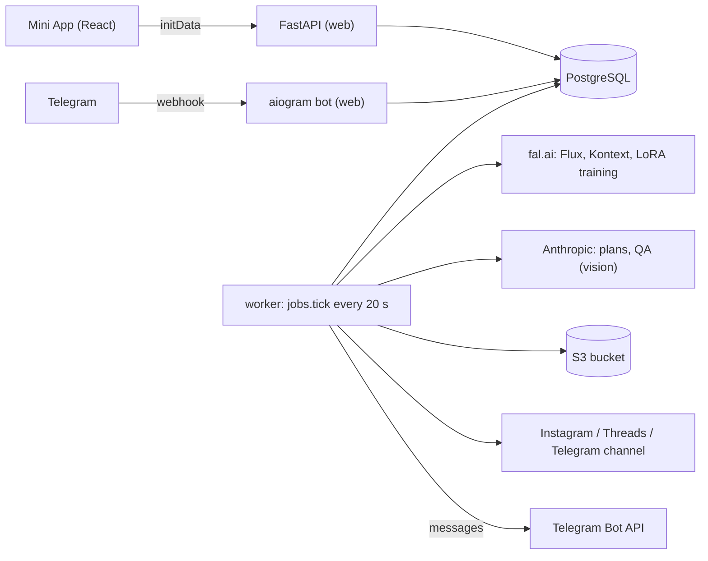
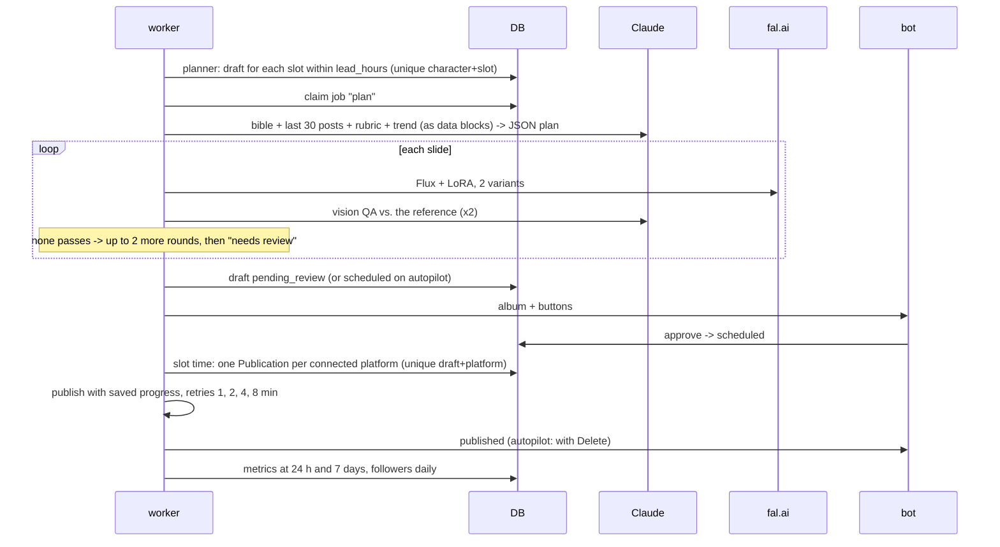

# Architecture

Purrpost is one FastAPI app plus a worker process over one PostgreSQL database. Everything slow or paid (image generation, LoRA training, publishing, metrics) runs in the worker; the API only reads, validates and enqueues.

## Layers

| Layer | Where | Role |
|---|---|---|
| API | `backend/app/api/` | Authenticate (`deps.py`: initData, invite gate, admin), check ownership, call a service |
| Services | `backend/app/services/` | Business logic in transactions: wizard (`characters.py`), `pipeline.py`, `schedule.py`, `approval.py`, `publishing.py`, `metrics.py`, `budget.py`, `queue.py`, `oauth.py` |
| Providers | `backend/app/providers/` | `LLM`, `ImageGen`, `LoraTrainer`, `Storage` Protocols with real clients (Anthropic SDK, fal.ai queue API, S3) and fakes |
| Publishers | `backend/app/publishers/` | `Publisher` Protocol: Instagram, Threads, Telegram channel, fake |
| Bot | `backend/app/bot.py` | `/start inv_CODE`, draft buttons, caption edit by reply. Handlers are thin: they call `services/approval.py` |
| Worker | `backend/app/jobs.py`, `worker.py` | Ordered steps, each in its own try/except |

All external calls go through the Protocols, so `DEV_FAKE_PROVIDERS=1` swaps every one for a fake (`build_ctx` in `main.py`) and tests script the fakes' answers.

## A post's life

## Data

`users`, `invite_codes`, `invite_redemptions` · `usage` (every paid call: provider, kind, units, $ estimate, `billed_to` shared/own) · `characters` (the bible, LoRA, schedule, autopilot, `lore`: the last 30 posts) · `character_images` (candidates, references, tests) · `jobs` · `drafts` (plan, slides with QA, status) · `bot_messages` (which bot message shows which draft, for caption replies) · `accounts` (encrypted tokens) · `publications` · `metrics` · `account_stats`. Timestamps are Unix milliseconds. Migrations: `backend/migrations`, `alembic upgrade head` on web start; CI runs `alembic check` so models and migrations can't drift.

## Guarantees

- **One draft per slot.** `uq_draft_slot (character_id, slot_ms)`: the planner can run any number of times or in parallel.
- **One job per piece of work.** `jobs.dedupe_key` is unique; workers claim with `UPDATE … WHERE status='queued'`, so a job runs once even with several workers. Retryable provider errors re-queue with backoff (30 s, 60 s, 120 s).
- **One post per platform.** `uq_publication (draft_id, platform)`. Publishers write progress (`children`, `container`, `media_id`, Telegram `message_ids`) into `publications.state`, which is saved on errors too; a retry resumes from it and never creates a second post. A publication stuck in `publishing` for 15 minutes (a dead worker) is taken over.
- **Money.** Failed LLM attempts are recorded too (they cost money). `budget.ensure` runs before every paid step; own-key providers are billed `own` and skip the shared limit.

## LLM answers

Claude is asked for JSON; `services/llm_json.py` takes it out of code fences and prose, repairs trailing commas, smart quotes and single quotes, then validates with pydantic. On failure it asks once more, quoting the error; after that the job fails with `llm_bad_json` and the user sees it. Image QA verdicts are re-checked in code: a slide passes only if every flag is clean, whatever the model says about itself. Requests use the server-side refusal fallback; a refusal surfaces as `llm_refused`.

## Known limits

- Instagram's API may not allow deleting a post; the Delete button then says to delete it by hand.
- The Telegram Bot API has no post statistics: channel posts have no metrics, only subscriber counts.
- Follower counts come from the account endpoints (`followers_count`); Threads needs the insights permission.
- Cost figures are estimates from `providers/pricing.py`; the providers' invoices are the truth.
